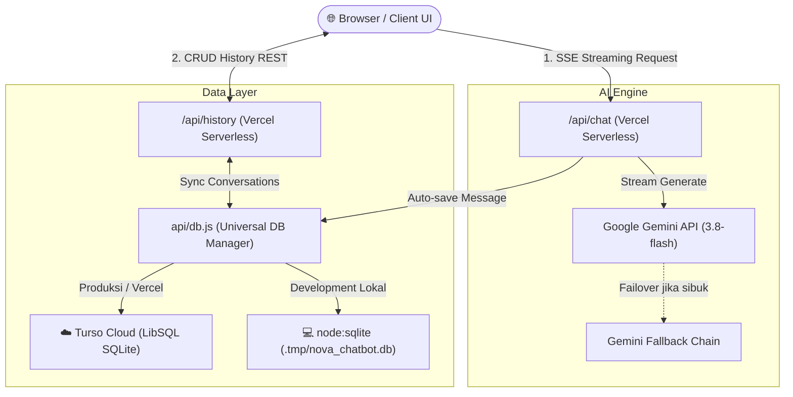

<div align="center">

# 🌌 NOVA — Next-Gen Gemini AI Chatbot

[](https://vercel.com)
[](https://aistudio.google.com)
[-00EB80?style=for-the-badge&logo=sqlite)](https://turso.tech)
[](https://nodejs.org)
[](LICENSE)

<p align="center">
  <b>Asisten AI Futuristik berperforma tinggi dengan antarmuka HUD Neon Cyberpunk, Streaming Respons Real-Time (SSE), Multi-Model Failover, dan Integrasi Database Cloud Turso (LibSQL) / SQLite CRUD.</b>
</p>

[Demo & Repository](https://github.com/oziajayakan/ChatbotAI.git) • [Dukung Pembuat via Saweria](https://saweria.co/kokbisaya) • [Dokumentasi API](#-arsitektur--api-reference)

</div>

---

## ⚡ Fitur Utama

- 🧠 **Multi-Model Failover Resilience**: Menggunakan model terbaru `gemini-3.8-flash` dengan mekanisme rantai cadangan otomatis (`gemini-3.7-flash` ➔ `gemini-3.5-flash` ➔ `gemini-flash-latest`) ketika terjadi spike demand / HTTP 503 / HTTP 429.
- ⚡ **Real-Time Token Streaming (SSE)**: Respons mengalir secara instan kata demi kata via *Server-Sent Events* dengan latensi ultra rendah.
- 🗄️ **Hybrid Database CRUD (Cloud & Local)**:
  - **Cloud Mode (Turso LibSQL)**: Penyimpanan riwayat obrolan persisten lintas serverless instance di Vercel secara gratis (*Free Tier 9 GB & 1 Miliar Reads/bulan*).
  - **Local Mode (Node.js `node:sqlite`)**: Berjalan otomatis tanpa konfigurasi rumit saat dijalankan di lingkungan lokal.
  - **Full CRUD Capabilities**: Create sesi, Read percakapan, Update judul, dan Delete riwayat pesan.
- 🎨 **Neural Core HUD Interface**:
  - Animasi visual torus vortex yang bereaksi terhadap status AI (*Idle*, *Thinking*, *Streaming*).
  - Telemetri token, detektor *Intent* lokal (Coding, Analysis, Writing, Math, dll.), serta live Reasoning Trace.
  - Layout responsif penuh (*full-screen view*) optimal untuk desktop maupun mobile.
- 🔒 **Serverless & Secure Architecture**: Kredensial API Key terlindungi sepenuhnya di server backend Vercel tanpa risiko terekspos ke sisi klien.

---

## 🏗️ Arsitektur Sistem



---

## 🚀 Panduan Memulai Cepat (Local Development)

### 1. Kloning Repositori
```bash
git clone https://github.com/oziajayakan/ChatbotAI.git
cd ChatbotAI
```

### 2. Instal Dependensi
```bash
npm install
```

### 3. Konfigurasi Environment Variables
Salin file `.env.example` menjadi `.env.local`:
```bash
cp .env.example .env.local
```
Buka `.env.local` dan masukkan kunci API Anda:
```env
# Wajib: Dapatkan gratis di https://aistudio.google.com/app/apikey
GEMINI_API_KEY=AIzaSy...

# Opsional: Database Cloud Turso (https://turso.tech)
TURSO_DATABASE_URL=libsql://your-db.turso.io
TURSO_AUTH_TOKEN=eyJhbGci...
```

### 4. Jalankan Server Lokal
```bash
npm start
```
Buka peramban Anda di `http://localhost:3000`.

---

## ☁️ Panduan Deploy ke Vercel

1. **Push proyek ke GitHub**: Pastikan repository Anda sudah up-to-date.
2. **Import ke Vercel**:
   - Masuk ke [Vercel Dashboard](https://vercel.com/dashboard) dan klik **Add New Project**.
   - Pilih repositori `ChatbotAI`.
3. **Atur Environment Variables**:
   Masuk ke menu **Environment Variables** di Vercel dan tambahkan:
   | Key | Value | Keterangan |
   | :--- | :--- | :--- |
   | `GEMINI_API_KEY` | `AIzaSy...` | API Key dari Google AI Studio |
   | `TURSO_DATABASE_URL` | `libsql://...turso.io` | URL database dari [Turso.tech](https://turso.tech) |
   | `TURSO_AUTH_TOKEN` | `eyJhbGci...` | Token akses database Turso |
4. Klik **Deploy** — Aplikasi Anda langsung aktif dan dapat diakses publik!

---

## 🗄️ Menyiapkan Cloud Database Gratis (Turso)

1. Kunjungi [Turso.tech](https://turso.tech) dan login menggunakan akun GitHub Anda.
2. Buat database baru:
   ```bash
   turso db create nova-chatbot
   ```
   *(Atau gunakan tombol **Create Database** pada dashboard web Turso)*.
3. Salin **Database URL** (`libsql://nova-chatbot-[username].turso.io`).
4. Generate token dengan mengklik tombol **Create Token** pada dashboard.
5. Tempelkan kedua nilai tersebut ke Vercel Environment Variables (`TURSO_DATABASE_URL` & `TURSO_AUTH_TOKEN`).

---

## 📡 API Reference

### 1. Chat Stream
- **URL**: `/api/chat`
- **Method**: `POST`
- **Headers**: `Content-Type: application/json`
- **Body**:
  ```json
  {
    "conversationId": "conv_1731700000_abc123",
    "messages": [
      { "role": "user", "content": "Halo, jelaskan arsitektur serverless!" }
    ]
  }
  ```
- **Response**: `text/event-stream` (Real-Time Chunked Stream)

### 2. History & Conversations CRUD
- **URL**: `/api/history`
- **Method**: `GET` | `POST` | `PUT` | `DELETE`
  - `GET /api/history` ➔ Menampilkan seluruh daftar riwayat obrolan.
  - `GET /api/history?id=<conv_id>` ➔ Mengambil seluruh isi percakapan & pesan.
  - `PUT /api/history` ➔ Mengedit judul percakapan atau isi pesan.
  - `DELETE /api/history?id=<conv_id>` ➔ Menghapus sesi percakapan dari database.
  - `DELETE /api/history?all=true` ➔ Membersihkan seluruh riwayat obrolan.

---

## 🤝 Dukungan & Kontribusi

Jika proyek ini bermanfaat bagi Anda, pertimbangkan untuk memberikan bintang 🌟 pada repositori ini atau mendukung melalui:

- ☕ **Saweria**: [https://saweria.co/kokbisaya](https://saweria.co/kokbisaya)
- 🐙 **GitHub Repository**: [https://github.com/oziajayakan/ChatbotAI.git](https://github.com/oziajayakan/ChatbotAI.git)

---

<div align="center">
  <sub>Dibangun dengan ❤️ oleh komunitas pengembang AI. Lisensi di bawah <a href="LICENSE">MIT License</a>.</sub>
</div>
